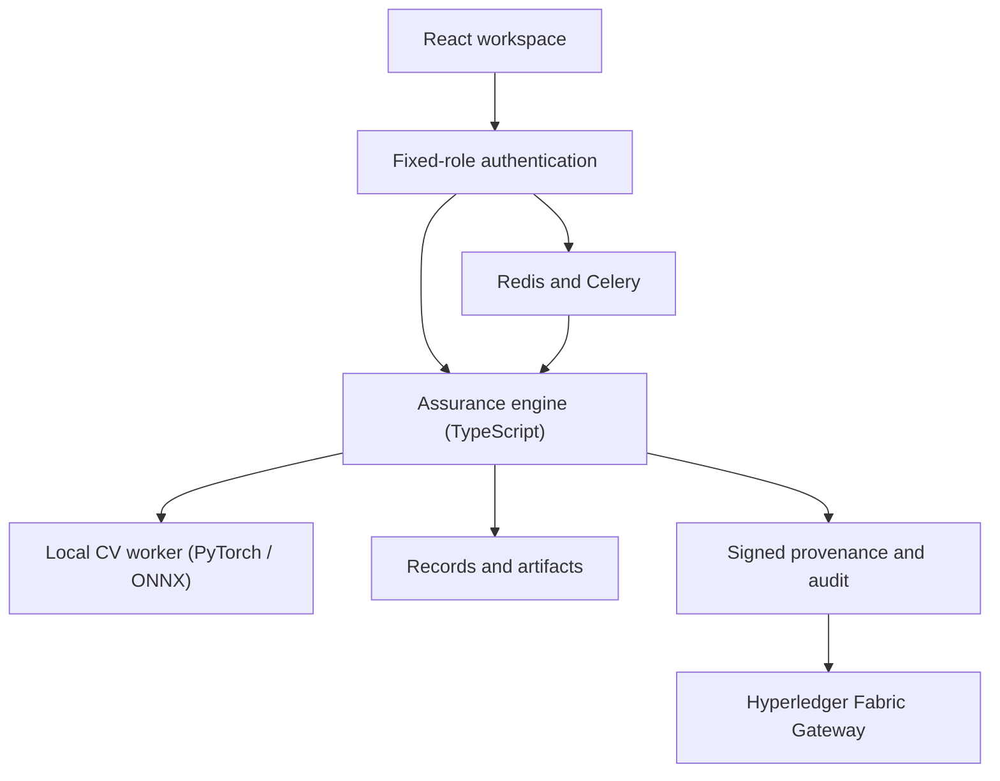

# 🛡️ SentinelCV 360

**Offline Computer Vision Trust, Integrity, Assurance and Forensics Platform**

Smart India Hackathon — **SIH26228: Trustworthy CV Integrity Assurance for Data, Models and Inference Outputs**

SentinelCV 360 covers the whole computer-vision lifecycle in one workspace: **datasets → models → inference outputs → evidence → signed reports**. It runs natively and offline, executes real pretrained models on CPU, and signs every inference record so tampering and replay can be detected.

> **Team:** _<team name>_ · **SIH ID:** _<team id>_ · **Demo video:** _<link>_ · **Screenshots:** see [`docs/screenshots`](docs/screenshots)

---

## What it does

| Stage | Capability |
|---|---|
| **Dataset integrity** | YOLO/COCO ingest, exact + near-duplicate detection (dHash, DINOv2), label anomalies (OpenCLIP), trigger/backdoor patch detection, OOD analysis (KNN, Ledoit-Wolf Mahalanobis) |
| **Model integrity** | SHA-256 identity, signed reference pinning, substitution detection, behavior probes across seven transforms, ONNX / TorchScript / safe PyTorch adapters |
| **Real pretrained engines** | DINOv2, OpenCLIP, YOLO11n, RT-DETR, Mask2Former, ResNet18, ConvNeXt-Tiny — run locally, digest-pinned, no runtime downloads |
| **Inference assurance** | Ed25519-signed provenance (model/input/config digests, runtime versions), tampering and replay detection (nonce + stream sequence) |
| **Operations** | Distribution-shift analysis (KS / PSI / MMD), confidence calibration, drift vs. manipulation, trust graph, blast-radius analysis |
| **Governance** | Fixed server-side roles (User, Client, Admin, Supervisor, Operator, Auditor), analyst → supervisor approval, tamper-evident audit, signed assurance reports, verifiable evidence packages |

## Architecture



FastAPI is the authenticated boundary and starts a private Node analysis engine. Native CV execution runs in a separate Python worker. The full stack adds Keycloak OIDC, PostgreSQL/pgvector/TimescaleDB, MinIO, Redis/Celery, Prometheus/Grafana and a Fabric contract. Details: [`docs/architecture.md`](docs/architecture.md), [`docs/security-model.md`](docs/security-model.md), [`docs/threat-model.md`](docs/threat-model.md).

## Tech stack

React 19 · Vite · Tailwind · TypeScript engine (Node 24) · FastAPI · PyTorch · ONNX Runtime · Ultralytics · Transformers · OpenCLIP · SQLite / PostgreSQL · MinIO · Redis / Celery · Keycloak · Hyperledger Fabric · Docker Compose

## Capability matrix (from [`FEATURE_STATUS.json`](FEATURE_STATUS.json))

| Capability | Status | Scope and limits |
|---|---|---|
| Username / password accounts | INTEGRATED | User, Client and Admin accounts with fixed server roles, admin provisioning, sessions, lockout and ownership checks. Hosted private platform access remains. |
| SHA-256 identity | INTEGRATED | Recomputed artifact bytes and pretrained file-tree digests; changed or missing weights fail execution. |
| Exact duplicates | INTEGRATED | Byte-identical image grouping. |
| Near duplicates | INTEGRATED | dHash and local DINOv2 cosine similarity; bounded samples, no field-calibrated confidence. |
| YOLO / COCO ingest | INTEGRATED | Bounded ZIP parsing and box validation, PNG/JPEG. |
| Label anomalies | INTEGRATED | Test-card feature classifier plus local OpenCLIP class disagreement. Scores require review; no proven malicious intent. |
| Trigger detection | INTEGRATED | Narrow 12×12 corner detector and finite native probe transforms. Arbitrary triggers are not covered. |
| OOD analysis | INTEGRATED | RGB fixture distances and local DINOv2 KNN / Ledoit-Wolf Mahalanobis; approved dataset baseline required. |
| Model substitution | INTEGRATED | Recomputed digest against a signed, administrator-pinned reference. |
| Behavior probes | INTEGRATED | Native classification, detection, segmentation and embedding comparison across seven transforms. A finite battery cannot establish universal safety. |
| ONNX / PyTorch / TorchScript | INTEGRATED | ONNX and TorchScript execute four explicit tensor contracts; safe PyTorch state dictionaries support ResNet18/50 and ConvNeXt-Tiny. Arbitrary Python modules and external ONNX data are rejected. |
| DINOv2 / OpenCLIP / YOLO / RT-DETR | INTEGRATED | All four executed on CPU with prepared, digest-pinned local weights. No runtime downloads. Weights are supplied separately from the hosted Site. |
| ResNet / ConvNeXt / Mask2Former | INTEGRATED | Pretrained classification and segmentation executed on CPU; local signed inference path tested. This is execution evidence, not field accuracy. |
| Neural Cleanse / STRIP / activation clustering | BACKEND IMPLEMENTED | STRIP entropy, activation clustering/spectral scores and optional bounded gradient reconstruction. Reconstruction supports ≤20 classification targets; thresholds are uncalibrated. |
| Signed inference provenance | INTEGRATED | Native output, model/input/config digests, adapter code, runtime and Ed25519 manifests. Container/hardware attestation remains unavailable. |
| Tampering / replay | INTEGRATED | Recomputed artifacts, signature verification, unique nonce and stream sequence; native and fixture paths tested. |
| Distribution shift | INTEGRATED | Pixel metrics and local DINOv2 embedding KS / PSI / MMD. Cause remains an interpretable heuristic. |
| Calibration | INTEGRATED | Measured sigmoid calibration on independent synthetic corner-trigger runs; pretrained anomaly scores are uncalibrated. |
| Risk / policies | INTEGRATED | Transparent threshold rules and hard failure overrides. Learned fusion and SHAP remain pending. |
| Trust graph / blast radius | INTEGRATED | Stored dependency traversal. Training lineage is declared, not proven. |
| Cases / two-person approval | INTEGRATED | Separate fixed-role identities and signed approval receipts; no hosted role switching. |
| Signed PDF / evidence package | INTEGRATED | PDF and ZIP hashes, Ed25519 manifests and pinned workspace-key verification. |
| Audit / Merkle roots | INTEGRATED | Hash chain, signed roots, recomputed anchored prefixes and optional external-ledger readback. External failures appear explicitly. |
| Hyperledger Fabric | BACKEND IMPLEMENTED | Real Gateway submit/commit/query, two-organization contract and Ed25519 key pinning. Contract tests pass; live peer startup is blocked here by denied netlink access. Ubuntu network acceptance remains. |
| Software keystore / key revocation | INTEGRATED | AES-GCM keys and custom attestations; local TLS CA generation. HSM/TPM custody and production organizational PKI remain pending. |
| Keycloak OIDC / realm roles | INTEGRATED | Local authorization-code PKCE, signed JWT checks, admin-created clients, strict roles and logout. Native HTTPS sign-in test; PostgreSQL deployment acceptance remains. |
| MFA / LDAP | BACKEND IMPLEMENTED | Keycloak accounts require OTP enrollment. Interactive MFA and LDAP federation have not been validated; no LDAP configuration is supplied. |
| PostgreSQL / pgvector / Timescale / MinIO | BACKEND IMPLEMENTED | API adapters, atomic batches, vector storage/search, time-series tables and versioned objects are wired. Service-level container validation remains. |
| Sensor adapters / video ingestion | NOT STARTED | Uploaded images work; RTSP, ONVIF, MAVLink, thermal, drone and continuous video adapters remain pending. |
| Prometheus / Grafana / Celery | BACKEND IMPLEMENTED | Protected process/application metrics, provisioned dashboard and role-scoped Redis/Celery jobs. Full service integration has not run here. |
| Offline preparation / startup | BACKEND IMPLEMENTED | Connected image/model preparation, separately trusted Ed25519 bundle verification, pull-never startup and isolated service network. Full disconnected Ubuntu test remains. |
| Signed update / rollback / encrypted backups | NOT STARTED | Bundle authenticity checking is implemented; atomic application updates, rollback and verified encrypted restore are not. |
| Unknown attacks | NOT STARTED | Detection is not guaranteed. No universal assurance or production-readiness claim. |

## Validation evidence

- Seven pretrained engines and the signed native inference path ran successfully on CPU: [`docs/native-ml-validation.json`](docs/native-ml-validation.json), [`docs/portable-model-validation.json`](docs/portable-model-validation.json)
- Keycloak HTTPS sign-in, account provisioning and role enforcement passed: [`docs/keycloak-validation.json`](docs/keycloak-validation.json)
- Test suite: `npm test`, plus `tests/*_smoke.py`. See [`docs/validation.md`](docs/validation.md)

## Honest status

The full container stack and live Fabric network have **not** passed acceptance in this release, and not every section of the original specification is complete. Model scores are execution evidence, not field-validated probabilities. See [`docs/coverage-matrix.md`](docs/coverage-matrix.md), [`docs/limitations.md`](docs/limitations.md) and [`docs/production-acceptance.md`](docs/production-acceptance.md).

## Run it

Quick start, native ML profile and offline stack: [`docs/quickstart.md`](docs/quickstart.md) and [`docs/setup-guide.md`](docs/setup-guide.md).

```bash
corepack pnpm install --frozen-lockfile
python3 -m venv .venv && source .venv/bin/activate
pip install -r local/requirements.txt
python local/setup.py            # prints admin/user/client passwords once
npm run build:local
uvicorn local.api:app --host 127.0.0.1 --port 8000
```

Pretrained weights are distributed separately as a signed model vault (see [`MODEL_VAULT_DOWNLOAD.txt`](MODEL_VAULT_DOWNLOAD.txt)); verify with `docs/model-vault-public.pem`.

## Credits

_<List every contributor and mentor and what each did.>_
