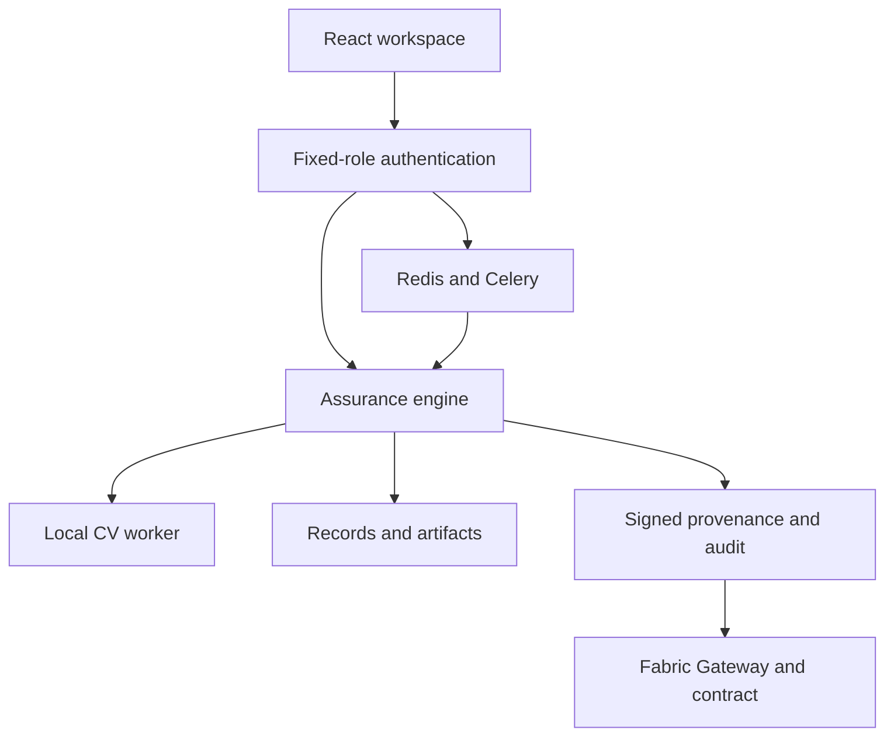

# Architecture

A shared TypeScript assurance engine manages records, hashing, policies, provenance, cases and reports. FastAPI provides the local authenticated boundary and starts a private Node process. A separate Python worker executes native CV models; PostgreSQL/MinIO and Fabric are behind authenticated private service adapters.

| Boundary | Private Site | Native Ubuntu | Full stack candidate |
|---|---|---|---|
| Authentication | Private platform gate plus workspace password accounts | Fixed-role scrypt sessions | Keycloak code/PKCE and strict realm roles |
| API | Worker route | FastAPI and private loopback Node | Same FastAPI/Node image behind TLS proxy |
| Records | D1 | SQLite WAL | PostgreSQL, pgvector and TimescaleDB adapters |
| Objects | R2 | Local filesystem | Versioned MinIO bucket |
| CV | Synthetic feature classifier | Seven pretrained engines and portable adapters | Same isolated AI worker image |
| Ledger | Local signed roots | Optional private Fabric Gateway | Two-org test-network contract/Gateway |
| Jobs/monitoring | Workspace counts | Protected metrics | Redis/Celery and Prometheus/Grafana |

Native execution records bind actual model digests, output bytes, preprocessing/configuration, adapter source hash and runtime versions. Model vault content is read-only in the stack. Missing or changed model files produce an error rather than a substitute score. Uploaded reference approval creates a separate signed byte snapshot.

Dataset embeddings are connected to sample IDs and written through the vector bridge when PostgreSQL is configured. Timescale metrics are stored by the bridge; Prometheus separately scrapes process and application metrics. Job ownership is persisted in Redis, and results require the initiating account identity. Infrastructure configuration does not prove these services passed runtime acceptance.

Graph relationships and sample/annotation evidence are persisted. A dataset-to-model training relationship remains a contributor declaration. Blast radius is potential impact rather than proof of compromise. Fixed separate accounts replace owner-controlled role simulation in both frontends.

The full stack is implemented but unvalidated as a combined deployment. HSM/TPM attestation, independent organizational PKI, LDAP federation and physical sensor/video adapters are still separate missing capabilities. See the coverage matrix and production acceptance checklist.
